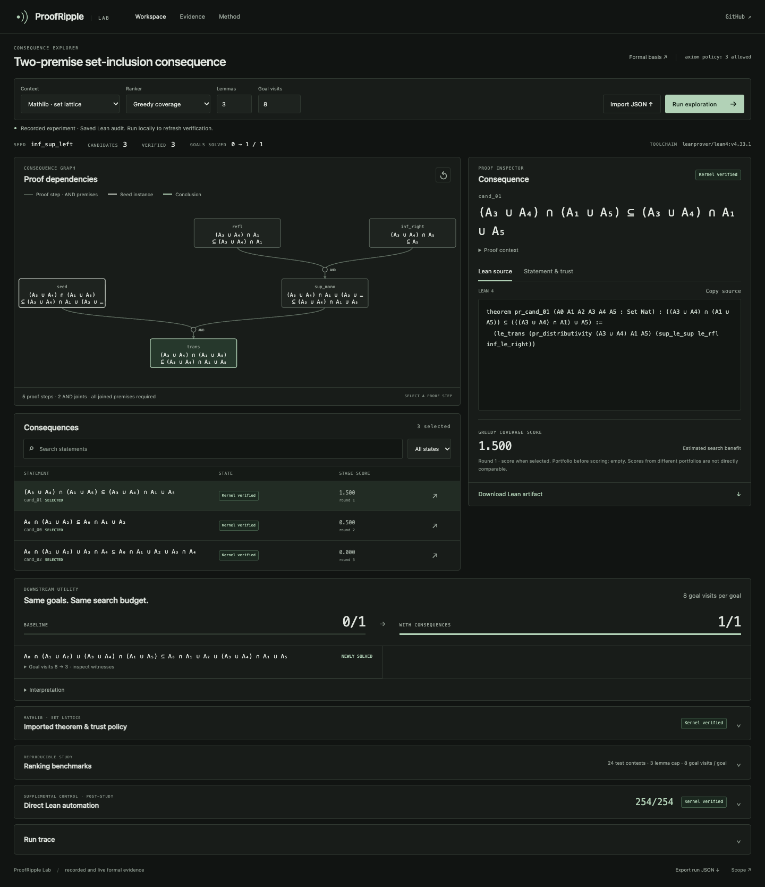

<p align="center"></p>
<p align="center">
<a href="https://github.com/nazeeh111/ProofRipple/actions/workflows/ci.yml"></a>


<a href="LICENSE"></a>
</p>

**Discover consequences. Check their proofs. Measure what they enable.**

ProofRipple is a small mathematical discovery engine with a practical research workbench. It imports a supported Lean theorem, derives reusable consequences, checks them in Lean, and tests whether supplying those consequences helps a bounded search solve later goals.

**v0.3 adds Mathlib set algebra and a substantially stronger ranking experiment.** The learned policy does not establish an advantage over dynamic greedy selection. All 1,997 expected declaration audits pass; separate general automation proves all 254 held-out goals after a documented preprocessing fix.

<p align="center"></p>

[Watch the actual LAB](docs/media/v0.3/walkthrough.mp4) · [Research report](docs/mathlib-research-report.md) · [Download v0.3](https://github.com/nazeeh111/ProofRipple/releases/tag/v0.3.0)

## Open the laboratory

Python 3.10+, CPU, no runtime Python dependencies or API keys. Recorded evidence opens without Lean. Fresh Mathlib checks require the pinned Lean toolchain and targeted Mathlib cache.

```sh
git clone https://github.com/nazeeh111/ProofRipple.git
cd ProofRipple
python3 -m venv .venv
source .venv/bin/activate
python -m pip install .
proofripple lab
```

Open **http://127.0.0.1:8765/lab/**. Choose Mathlib set algebra, trace a consequence, inspect the actual proof tree and assumptions, change ranking or budgets, and export the Lean source. The darker, compact interface puts the graph, proof and candidate choices first. Detailed evidence stays available in expandable panels.

For fresh formal verification, [install elan](https://github.com/leanprover/elan), then:

```sh
elan toolchain install leanprover/lean4:v4.33.1
python3 scripts/setup_mathlib.py
proofripple doctor
proofripple demo --domain mathlib --out outputs/mathlib-demo
```

The setup fetches the required lattice/set cache, not a full Mathlib build. [Pinned runtime and offline checks](docs/mathlib-setup.md).

## From a theorem to a useful consequence

The [canonical Mathlib example](examples/mathlib_sets.json) starts from `inf_sup_left`, a distributivity theorem. Expressions describe unions and intersections of six arbitrary `Set Nat` variables. The engine applies checked lattice rules, including genuinely two-premise steps.

1. **Import** the registered theorem and inspect its exact Lean type, dependencies and axioms.
2. **Explore** seed-dependent consequences, excluding recognized identities, prior-index statements and held-out answers.
3. **Prove** candidates in an independent pinned Lean process. The example passes all 15 expected declaration audits.
4. **Evaluate** the selected portfolio: with three lemmas and eight goal visits, the example improves from **0/1 to 1/1**.
5. **Inspect and reuse** the actual AND/OR proof tree and [exported Lean source](artifacts/mathlib/Demo.lean).

This hand-declared example illustrates the workflow. Performance claims use the separate frozen study below. The facts are known mathematics; a bounded search failure does not establish mathematical necessity or global novelty.

## Does learned ranking help?

The prospectively frozen study uses **40 training, 12 validation and 24 test contexts**, with **254 retained test goals**. Twenty-three test contexts have more candidates than the largest five-lemma budget. All ten policies use the same candidate pools and nine fixed combinations of lemma and search budgets.

The compact seven-member ridge ensemble predicts usefulness conditional on the already selected portfolio. Its 6,180 training examples include zero outcomes, structural features, symbolic syntax hashes, training-only rule reuse and portfolio features. It rescores after every choice. It uses no pretrained embeddings, language model or graph neural network.

| Selection policy | Mean gain over starting registry, all nine profiles |
| --- | ---: |
| Dynamic greedy coverage | +25.46 pp |
| Complementary-branch heuristic | +25.03 pp |
| Structural learned ablation | +24.85 pp |
| Portfolio-aware learned ensemble | +24.82 pp |
| Static structural estimate | +24.46 pp |
| Singleton/static learned ablation | +23.06 pp |

The primary learned-minus-greedy difference is **−0.64 percentage points**, with a paired context bootstrap interval of **[−1.55, +0.20] pp**. This does not establish a learned advantage. At the default three-lemma/eight-visit profile, learned solves **82/254**, greedy **96/254**, and the starting registry **0/254**. These raw totals use a different weighting from the primary context average.

All nine profiles, ten policies, five random repetitions, ablations, costs, decisions and uncertainty are published. Repeated goals across budget profiles are not independent tasks. No test-driven model or budget tuning was used to force a win.

**General automation solves all 254 goals unaided.** The original registered control failed because preprocessing treated “nothing to simplify” as an error. Its failed bundles remain published. A separate post-study repair inserts only `try` before the same preprocessing tactic; all exact goal types and resource limits are preserved, and fresh checks pass 254/254. This puts the bounded-search gains in context and makes no unrestricted prover-superiority claim. [Control provenance and independent review](docs/independent-review-v0.3.md).

```sh
# Full fixed study; CPU training plus fresh Lean checks can take about half an hour
proofripple benchmark --domain mathlib --certify \
  --frozen-protocol artifacts/mathlib --out outputs/reproduction

# Reproduce the separately repaired automation control
python3 scripts/mathlib_automation_control.py \
  --contexts artifacts/mathlib/contexts.json.gz \
  --original-controls artifacts/mathlib/automation \
  --out outputs/repaired-control

python -m unittest discover -s tests -v
```

[Full results](docs/mathlib-research-report.md) · [Frozen protocol](artifacts/mathlib/frozen-protocol.json) · [Prospective review](docs/mathlib-protocol-review.md) · [Independent artifact review](docs/independent-review-v0.3.md)

## Import and integrate

```sh
proofripple import-declaration inf_sup_left --out outputs/imported
proofripple discover examples/mathlib_sets.json --out outputs/custom
proofripple export-seed examples/mathlib_sets.json --out outputs/MathlibSeed.lean
proofripple discover outputs/MathlibSeed.lean --out outputs/from-lean
proofripple demo --domain mathlib --method learned --select 3 --out outputs/learned
```

The declaration registry currently supports `inf_sup_left` and `List.length_filter_le`. JSON describes validated typed expressions. The Lean importer accepts the canonical exported format and rejects appended executable commands. Arbitrary uploaded Lean modules are not executed. [Mathlib API](docs/mathlib-api.md) · [General CLI/Python API](docs/api.md).

## Trust and scope

Lean's kernel checks generated proof terms in independent memory/time-bounded processes. Exact statements, expected audit coverage, source/context hashes, dependencies and transitive axioms are retained. Mathlib permits only the standard `propext`, `Classical.choice` and `Quot.sound` foundations; custom, admitted and native-computation axioms fail closed. Imported JSON statuses are reported evidence, not self-authenticating proof.

Positive Boolean normal forms and joint variable renaming guard dataset exclusions. Search cannot use that semantic oracle as a free proof step or ranking feature. This is generated structural/statement holdout within a restricted positive-set language, not transfer to unrelated mathematics or an unrestricted Mathlib index. Formal validity does not certify empirical bookkeeping or natural-language fidelity; independent replay checks the experiment separately.

Selection and training add costs beyond the common lemma/goal-visit budgets. Selected facts can guide midpoint search as well as compress proofs. Ensemble disagreement is not a calibrated probability. Immediate marginal labels can miss future partner value. Explanations are deterministic templates grounded in actual witnesses.

## Earlier domains and research

The preserved [v0.2 list-capacity study](docs/natural-research-report.md) composes filtering, mapping, reversal and prefix bounds. Its learned policy ties graph/proof-cost selection at 15/61, with only two contexts offering a ranking choice. A separate [paired `grind` case study](docs/budgeted-automation.md) records a local automation benefit at a fixed generation limit. The [v0.1 implication testbed](docs/research-report.md) remains available.

```sh
proofripple demo --domain lists --out outputs/lists
proofripple demo --domain implications --out outputs/logic
```

[Research foundations](docs/research-foundations.md) examines theorem-discovery studies, Lean/Mathlib, MathVet, Prove2Me, Verso Blueprint, PaperVizAgent and the optional OpenAI/math case study. The contribution is an auditable theorem-to-consequence-to-utility workflow; ridge regression, bootstrap ensembles, feature hashing and graph search are established methods.

[Architecture](docs/architecture.md) · [Methodology](docs/methodology.md) · [Contributing](CONTRIBUTING.md) · [Changelog](CHANGELOG.md)

MIT licensed. Lean and optional Mathlib are separately installed Apache-2.0 dependencies. [Attribution and media provenance](NOTICE.md).
