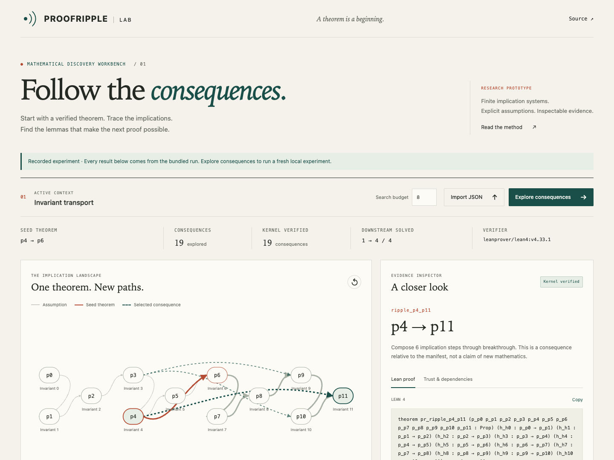

<p align="center"></p>
<p align="center">
  <a href="https://github.com/nazeeh111/ProofRipple/actions/workflows/ci.yml"></a>
  
  
  <a href="LICENSE"></a>
</p>

**A theorem matters for what it enables.** ProofRipple explores consequences of a verified seed theorem, selects reusable intermediate lemmas, checks their proof terms in a fresh Lean process, and measures whether they help solve further goals under a fixed search budget.

**v0.1 is a bounded research prototype for finite propositional implication systems.** It includes a trained usefulness model and an interactive laboratory. It does not discover new human mathematics, ingest arbitrary Lean/Mathlib modules, or claim to outperform established theorem provers.

<p align="center"></p>

[Watch the actual LAB walkthrough](docs/media/walkthrough.mp4) · [Mobile preview](docs/media/lab-mobile.png)

## Try the laboratory

Python 3.10+; Lean is needed for fresh formal checks. Recorded evidence is available without Lean. No API keys, network model calls, GPU, or runtime Python dependencies.

```sh
git clone https://github.com/nazeeh111/ProofRipple.git
cd ProofRipple
python3 -m venv .venv
source .venv/bin/activate
python -m pip install .

# With elan installed: https://github.com/leanprover/elan
elan toolchain install leanprover/lean4:v4.33.1
proofripple doctor
proofripple demo --out outputs/demo
proofripple lab
```

Open **http://127.0.0.1:8765/lab/**. Inspect the recorded experiment, choose a consequence, trace its proof dependencies, compare downstream searches, or run a fresh local experiment. Wheel and evidence bundles are available in [Releases](https://github.com/nazeeh111/ProofRipple/releases).

The interface distinguishes recorded evidence from a live run. JSON imports are supplied evidence until rerun locally. A missing verifier leaves results proposed; it never creates a green verification state.

## A real, inspectable ripple

The included [invariant-transport context](examples/invariants.json) declares 12 propositions and 11 implication assumptions. Its seed proves `p4 → p6` by composing two assumptions. These proposition labels are abstract: their mathematical meaning is exactly the quantified Lean statement.

1. **Import:** reproduce the seed proof in pinned Lean.
2. **Understand:** index explicit hypotheses and the seed's witness.
3. **Explore:** enumerate 19 distinct, seed-dependent consequence candidates. Existing edges, identity statements, and direct answers to the evaluation goals are excluded.
4. **Prove:** Lean checks the seed, all 19 candidates, and 5 successful downstream proof witnesses. All 25 declarations have **empty transitive axiom lists**.
5. **Evaluate:** at 8 node expansions per goal, the starting library solves **1/4** goals; adding 3 selected intermediate lemmas solves **4/4**.
6. **Explain:** inspect witness-grounded explanations and export the complete [Lean artifact](artifacts/Demo.lean) or [run receipt](artifacts/demo.json).

The goals are absent from the offered lemma set. For example, a selected `p4 → p11` lemma helps searches starting at `p0`, `p1`, or `p2`. These are known logical consequences made reusable, not claims of mathematical originality. The [no-gain example](examples/no_gain.json) preserves a genuine failure case.

## Does learning help?

The frozen experiment trains a **7-member context-bootstrap ridge ensemble** on 1,302 candidate examples from 16 graphs, checks 6 validation graphs, and evaluates 12 disjoint test graphs with 20 goals each. The model predicts one-lemma marginal downstream solve rate from 12 structural and task features. Ensemble disagreement drives a modest exploration bonus; overlapping witnesses receive a redundancy penalty.

Every policy selects 3 lemmas and receives the same candidate pool and 8 BFS node expansions per goal. The starting library already includes the seed theorem. Five random repetitions are averaged within each test context.

| Selection policy | Mean solved / 20 | Net gain over starting library | 95% context-bootstrap interval for gain |
| --- | ---: | ---: | ---: |
| Starting library | 4.917 | — | — |
| Goal-aware graph heuristic | **8.750** | **+3.833** | [2.583, 5.083] |
| Learned usefulness ensemble | 8.583 | +3.667 | [2.167, 5.167] |
| Lexical similarity | 6.333 | +1.417 | [0.833, 2.167] |
| Random | 6.317 | +1.400 | [0.933, 1.867] |
| Shortest primitive proof first | 4.833 | −0.083 | [−0.750, 0.833] |

**The learned model does not beat the strong graph heuristic.** It improves over weaker baselines in this experiment. Net gains include regressions: adding a lemma can change BFS queue order and make a previously solved goal miss its budget. There is no claim of equal wall time, calibrated confidence, learned semantic embeddings, or transfer to Mathlib.

Read the [research report](docs/research-report.md), [exact protocol](docs/methodology.md), [frozen results](artifacts/benchmark.json), and [training/test contexts](artifacts/contexts.json). All candidate and successful test-policy proof witnesses are separately certified in Lean; the report records per-context hashes and audit counts. The [full audit](artifacts/benchmark-audits.json.gz) is gzip-compressed; [proof sources](artifacts/proofs) remain directly inspectable.

```sh
# Full training, evaluation, and independent formal certification
proofripple benchmark --out outputs/reproduction --certify
python -m unittest discover -s tests -v
```

## Bring a supported theorem

```sh
proofripple discover examples/invariants.json --out outputs/custom
proofripple export-seed examples/invariants.json --out outputs/Seed.lean
proofripple discover outputs/Seed.lean --out outputs/from-lean

# Exploration only: results stay proposed
proofripple discover examples/no_gain.json --no-verify --out outputs/no-gain
```

A context contains propositions, explicit implication hypotheses, a seed theorem's composable witness, and optional downstream goals. The supported `.lean` importer accepts the canonical exported implication format and reproduces its proof. It rejects extra commands and arbitrary source modules. See the [format and Python API](docs/api.md).

## Trust is a first-class result

- **Lean decides validity.** Search produces witnesses; a fresh pinned Lean subprocess checks generated proof terms and audits every expected declaration. Missing audits, unexpected axioms, compilation errors, and timeouts fail closed.
- **No admitted proofs.** The default policy requires an empty axiom list, rejecting `sorryAx`, custom axioms and compiler-dependent native-evaluation axioms. Tests exercise real poisoned proofs.
- **Reproducible evidence.** Run artifacts retain exact statements, assumptions, proof constants, source/context hashes, toolchain, search budgets and results. Fresh certification rebuilds incoming proof/status fields.
- **Honest novelty.** Distinct endpoints relative to an indexed manifest are not global mathematical novelty. Lean validity does not certify a natural-language interpretation. Bounded failure is not mathematical necessity.

## How it fits the research

ProofRipple's contribution is an integrated, auditable **consequence-to-downstream-utility loop**, with an inexpensive measured ranking experiment. Ridge regression, bootstrap ensembles, uncertainty bonuses and graph search are established techniques; this project does not present them as new algorithms.

The design is informed by [Self-Supervised Theorem Discovery](https://arxiv.org/abs/2606.28747), [Learning to Discover Interesting Mathematics](https://arxiv.org/abs/2609.28603), [AI and the Structure of Mathematics](https://arxiv.org/abs/2604.06107), and [Lean Graph Search](https://arxiv.org/abs/2610.22339). See [research foundations](docs/research-foundations.md) for methods, limitations, MathVet's statement-fidelity distinction, Prove2Me, Verso Blueprint, and a carefully scoped path to the optional OpenAI math collection.

## Limitations

This first release is a controlled logic testbed. All benchmark graphs come from one procedural family; different seeds are not evidence of new-domain generalization. Goal endpoints are visible to all rankers, while test outcomes and proof bodies are withheld from training. Candidate enumeration has access to the frozen primitive graph. It already knows reachability; the measured problem is which intermediate consequences make bounded searches cheaper.

There is no unrestricted Lean importer, Mathlib index, language model, graph neural network, natural mathematical originality detector, human statement-fidelity review, or evidence of solving open problems. Explanations are deterministic witness-grounded templates. The compact model uses structural features rather than pretrained embeddings or a historical Mathlib reuse corpus. Large theorem-library evaluation remains future work, described in [the research report](docs/research-report.md).

## Project map

| Component | Purpose |
| --- | --- |
| `proofripple/engine.py` | Candidate discovery, bounded search, baseline policies |
| `proofripple/model.py` | Training and uncertainty-aware usefulness ranking |
| `proofripple/lean.py` | Closed-format imports, proof construction and axiom audits |
| `proofripple/benchmark.py`, `certification.py` | Frozen experiments and per-context formal certification |
| `lab/` | Dependency-free interactive research workbench |
| `artifacts/`, `examples/` | Real reproducible evidence and supported theorem inputs |

[Architecture & trust boundary](docs/architecture.md) · [Contributing](CONTRIBUTING.md) · [Independent review](docs/independent-review.md) · [Release notes](CHANGELOG.md)

MIT licensed. Lean is a separately installed Apache-2.0 dependency. No paper figures, external theorem corpora or third-party application source are vendored; [attribution](NOTICE.md) records the research and media provenance.
