# Architecture and trust boundary

```mermaid
flowchart LR
  I[JSON or canonical Lean seed] --> C[Validate frozen context]
  C --> G[Enumerate seed-dependent consequences]
  G --> R[Trained usefulness ensemble or baseline]
  R --> S[Equal-budget downstream searches]
  G --> P[Construct explicit proof terms]
  S --> P
  P --> L[Fresh pinned Lean subprocess]
  L --> A[Exact type and transitive axiom audit]
  A --> E[Hashed run and reusable Lean artifact]
  E --> U[LAB graph and evidence inspector]
```

Python proposes proof trees or implication paths and allocates a bounded search budget. Lean separately
checks that the emitted expressions inhabit the claimed theorem types. The
adapter only stamps a complete run verified after process success, exact audit
coverage, and the explicit domain axiom policy: empty for implications,
propext-only for concrete lists, and the three standard foundational axioms for
the Mathlib set domain. The input domain cannot introduce arbitrary
Lean expressions or executable commands. Pinning uses `ELAN_TOOLCHAIN` for the
child, without changing the user's default toolchain.

The visualization uses context edges or actual binary proof trees from the run.
It is not a graph of every possible mathematical implication. The dependency
inspector reports constants extracted from the actual Lean proof, while explicit
quantified hypotheses are visible in the theorem type/source. Imported JSON
evidence is inspectable but must be rerun for independent local assurance.

Models are small JSON arrays. The Mathlib workflow requires the frozen training
artifact for learned policies; a missing model does not trigger a fit on the
requested workload. Legacy adapters retain their documented fallbacks. Enumeration reuses frozen
graph paths where available; proofs are freshly checked rather than promoted
from an unvalidated disk cache. Expensive searches are bounded and optional.

The LAB is plain HTML/CSS/JavaScript. The Python standard library serves only
the workbench's data/assets/docs over loopback. There are no cloud services,
analytics, accounts, paid endpoints or browser API credentials.

## Mathlib set-algebra adapter

The new domain interprets validated `var`, `join` and `meet` terms as unions and
intersections of six arbitrary `Set Nat` values. It instantiates the pinned
Mathlib theorem `inf_sup_left` and constructs consequence proofs using explicit
binary bounds, monotonicity and transitivity. The formal adapter checks each
child interface, selected-lemma reference and final endpoint before emitting
only registered Lean templates. It records direct checked-body constants; it
does not implement a general normalized dependency analyzer.

Dataset exclusion uses positive Boolean DNF antichains and joint variable
renaming. Runtime proof search uses raw syntax and charges attempted goal
visits, including failed branches and memo/cycle checks. A bounded shared raw
obligation index supplies both learned and heuristic features. Its cache is
syntactic preprocessing, with cache work reported separately from goal visits.

The learned policy predicts marginal benefit conditioned on the current
portfolio and rescores after each choice. Training uses fixed candidate-excluded
partner sets drawn only from training contexts. A singleton/static fit remains
an ablation. Neither the structural heuristics nor model features run hidden
held-out solve probes. Candidate facts may affect search guidance as well as
replace a proof subtree.

Mathlib is an optional pinned local runtime. Setup fetches two module dependency
closures; verification runs the already installed compiler with explicit library
paths and does not invoke dependency downloads. Every retained test goal also
receives a separate pointwise-unfolded `aesop` control with no generated facts.
See [setup](mathlib-setup.md), [API](mathlib-api.md), and the versioned
[prospective protocol](../artifacts/mathlib/frozen-protocol.json).

## Concrete List Nat adapter

The natural adapter validates an expression AST before search. Each node is
a real stage-length bound. It proves every primitive arrow from registered
Lean List/Nat facts, then composes those named proof constants into candidates
and successful downstream witnesses. The imported `List.length_filter_le`
entry is audited directly from Lean's checked environment.

A sound partial canonicalizer removes common shared-predicate/k equivalences
before training or ranking. The generic rewrite rules have Lean proofs, and
a separate reviewer checks the implementation. Exact normalized held-out goal
pairs, identities, existing pairs and duplicate pairs are excluded from every
policy's common pool. This is not a complete equivalence oracle.

A separate standard-library automation source contains only stage definitions
and the showcase goals, with no seed/candidate/helper declarations. Its stronger
`grind` control is reported alongside registry-bounded search results. Proof
validity, empirical search outcomes, formal statement fidelity, and mathematical
originality remain distinct claims.
