# Architecture and trust boundary

```mermaid
flowchart LR
  I[JSON or canonical Lean seed] --> C[Validate frozen context]
  C --> G[Enumerate seed-dependent consequences]
  G --> R[Trained usefulness ensemble or baseline]
  R --> S[Equal-budget downstream searches]
  G --> P[Construct explicit proof terms]
  S --> P
  P --> L[Fresh pinned Lean subprocess]
  L --> A[Exact type and transitive axiom audit]
  A --> E[Hashed run and reusable Lean artifact]
  E --> U[LAB graph and evidence inspector]
```

Python proposes paths and allocates a bounded search budget. Lean separately
checks that the emitted expressions inhabit the claimed theorem types. The
adapter only stamps a complete run verified after process success, exact audit
coverage, and an empty axiom list. The input domain cannot introduce arbitrary
Lean expressions or executable commands. Pinning uses `ELAN_TOOLCHAIN` for the
child, without changing the user's default toolchain.

The visualization uses context edges and selected proof witnesses from the run.
It is not a graph of every possible mathematical implication. The dependency
inspector reports constants extracted from the actual Lean proof, while explicit
quantified hypotheses are visible in the theorem type/source. Imported JSON
evidence is inspectable but must be rerun for independent local assurance.

Models are tiny JSON arrays loaded once per CLI run. The Python API lazily trains
and caches a deterministic model when none is supplied. Enumeration reuses frozen
graph paths where available; proofs are freshly checked rather than promoted
from an unvalidated disk cache. Expensive searches are bounded and optional.

The LAB is plain HTML/CSS/JavaScript. The Python standard library serves only
the workbench's data/assets/docs over loopback. There are no cloud services,
analytics, accounts, paid endpoints or browser API credentials.
