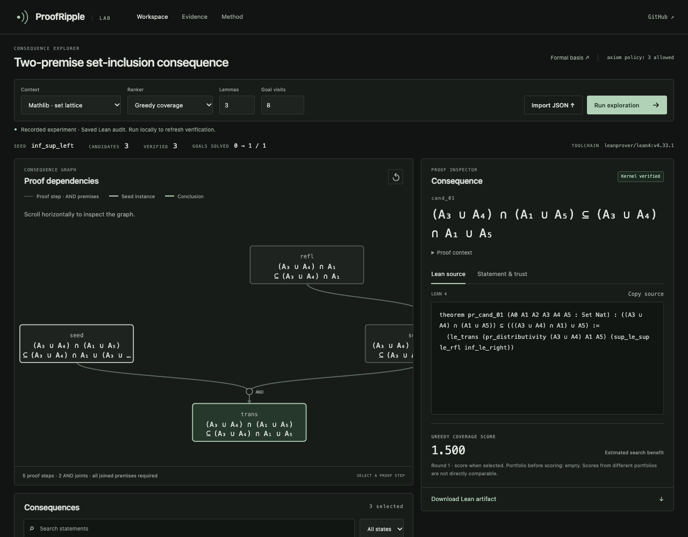

# Current workbench capture

Unedited browser capture from the installed 0.3.2.dev0 successor on November 16, 2026, at 1280 × 1000 pixels. SHA-256: `eca61e4e23232ba50097abbc3a589544937b8b80e6d02418136b23ba797e832d`. The exact LAB HTML, JavaScript and CSS match the packaged source. The earlier v0.3 captures, walkthrough and recorded studies remain unchanged.

This screen displays the retained Mathlib example: three consequences and a five-step dependency graph with two AND joints. The banner identifies recorded evidence. It is not a fresh Mathlib certification. The graph is intentionally horizontally scrollable to preserve readable mathematical labels; keyboard focus and ArrowRight scrolling were checked at 320 pixels.

The current interface uses an accessible group around its individually focusable proof buttons. Native keyboard selection still exposes the full relation and required premises. Automated WCAG A/AA checks at 320, 390 and 1280 pixels report no confirmed violations, with one incomplete contrast check on SVG content per scan. These results do not establish screen-reader acceptance, physical touch behavior or performance on large imported graphs.

A separate bounded implication exploration ran through the actual installed browser/server workflow. The browser's downloaded Lean source was independently rechecked using the existing Lean 4.33.1 executable: 25 declaration audits, all without axioms. Its context, candidates, selection, goals, budget, metrics and proof source match the earlier interface's identical run. Exported JSON reopens exactly; the interface labels imported verification as file-reported, and a malformed import preserves the complete previous run.

A fresh Mathlib attempt in this installed environment reports verification unavailable and marks consequences proposed because the optional pinned Mathlib cache is absent. No Mathlib cache was acquired, no model was retrained and no study was rerun for this product verification. The installed artifact checker validates the retained 1,997 recorded audits and 254 repaired-control records structurally; those checks are not fresh formal executions. The original full reproduction commands remain in the main documentation.
