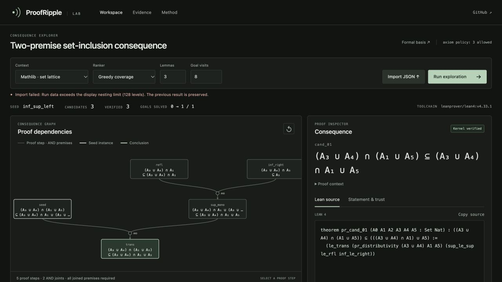

# v0.3.1 release gap review

This patch closes concrete product and distribution gaps found after v0.3.0.
The frozen Mathlib experiment, model, data, original failed controls and repaired
control evidence are unchanged.

## Imported runs preserve the active result

A valid JSON file with an object-valued ranking method could change the active
context before rendering raised an error. The failure notice incorrectly claimed
the previous result was preserved. Independent review reproduced further cases
in null budgets, goal counters, graph labels and deeply nested dependency data.

Presentation validation now precedes state changes and checks the fields used
by the renderer. An iterative whole-tree check bounds nesting before any later
serialization. Twenty-two Node contract checks exercise all three actual recorded
domains and malformed data through the real loader with an existing valid run.
The browser reproduction confirms the same proof, method, totals and enabled
export remain after rejecting the malformed files. These shape checks do not
certify an imported theorem or authenticate file-reported statuses.

## Installed evidence is complete

The previous wheel omitted nine evidence/script targets linked from its bundled
documents. The wheel now includes the frozen corpus, source snapshots, proof
collections, compressed audits and reproduction drivers. An offline installed
asset checker follows every local documentation link and checks frozen source,
corpus, model, certificate-source and audit hashes. CI runs this check against
the installed package from outside the checkout on all three Python versions.

The loopback server provides proof-directory indexes, compressed audit downloads
and read-only driver source. The new route tests cover actual HTTP responses,
HTML/URL escaping, exact compressed bytes, allowed same-origin requests on an
OS-assigned port, and denied Host, Origin and path/suffix cases. Python files are
served as plain text. Static requests never execute them.

The existing README Scope anchor is restored. The v0.3.0 release, its media and
scientific record remain preserved. Final release-specific CI and public-asset
verification are linked in the v0.3.1 release notes.
